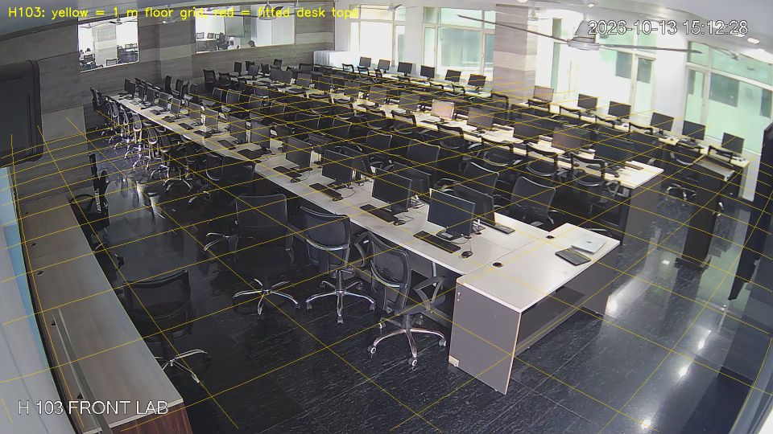
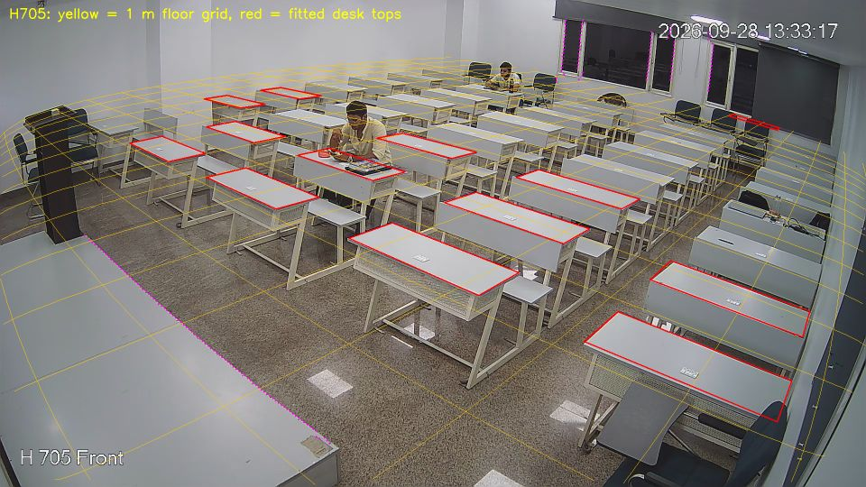
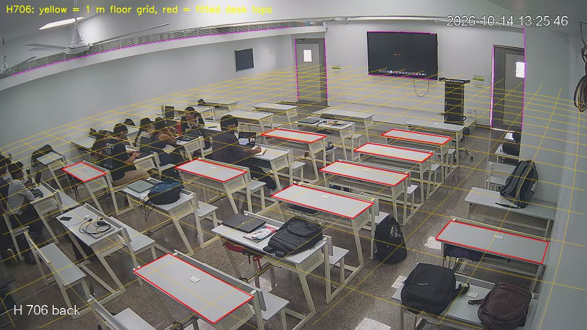

# Camera calibration (T2.3–T2.5)

Generated 2026-10-22 14:35 by `scripts/calibrate_cameras.py`. Full camera model per room (focal length, radial lens distortion k1/k2, position and orientation), floor at Z = 0. Inputs: `configs/calibration/<room>.yaml`; outputs: `configs/cameras/<room>.yaml`. All values approximate.

## H103 (cam04)

| Quantity | Value |
| --- | --- |
| edge_rms_px | 4.0 |
| vertical_rms_px | 0.81 |
| f_px | 1356.5 |
| k1 | -0.305 |
| k2 | 0.041 |
| camera_above_table_m | 1.826 |
| table_height_m | 0.676 |
| camera_above_floor_m | 2.502 |
| camera_above_floor_without_prior_m | 2.286 |
| camera_above_floor_measured_m | 2.58 |
| camera_height_used_as_soft_constraint | True |
| edge_x0.56_found_m | 0.705 |
| edge_x5.80_found_m | 5.888 |
| edge_x6.92_found_m | 6.886 |
| edge_x8.68_found_m | 8.862 |
| edge_x9.24_found_m | 9.294 |
| camera_distance_from_front_wall_m | 0.132 |

## H705 (cam01, cam02)

| Quantity | Value |
| --- | --- |
| reprojection_rms_px | 4.22 |
| line_rms_px | 2.84 |
| f_px | 1308.1 |
| k1 | -0.259 |
| k2 | 0.0 |
| desk_top_depth_m | 0.387 |
| camera_above_desk_m | 1.452 |
| row_pitch_fit_m | 0.992 |
| row_pitch_measured_m | 0.96 |
| column_pitch_fit_m | [1.72, 1.66, 1.787, 1.573] |
| column_pitch_measured_m | [1.75, 1.79, 1.8, 1.75] |
| desk_height_m | 0.778 |
| camera_above_floor_m | 2.23 |

## H706 (cam03)

| Quantity | Value |
| --- | --- |
| reprojection_rms_px | 3.64 |
| line_rms_px | 1.83 |
| f_px | 1433.8 |
| k1 | -0.396 |
| k2 | 0.12 |
| desk_top_depth_m | 0.375 |
| camera_above_desk_m | 1.769 |
| row_pitch_fit_m | 0.866 |
| row_pitch_measured_m | 0.96 |
| column_pitch_fit_m | [1.742, 1.762, 1.84] |
| column_pitch_measured_m | [1.75, 1.79, 1.8, 1.75] |
| desk_height_m | 0.8 |
| camera_above_floor_m | 2.569 |
| door_left_width_m | 1.19 |
| door_left_camera_above_floor_m | 2.725 |
| door_left_wall_distance_m | 10.895 |
| door_right_width_m | 0.917 |
| door_right_camera_above_floor_m | 2.713 |
| door_right_wall_distance_m | 10.476 |
| door_width_measured_m | 1.12 |

